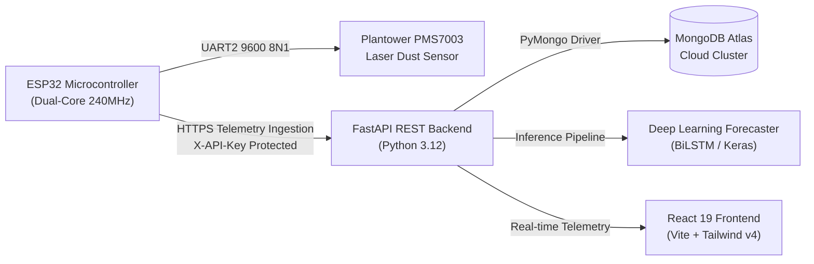

# AERO

**AirPurify AI / AeroSense AI** — Intelligent Real-Time IoT Air Quality Monitoring, Predictive Machine Learning Forecasting, and Smart Cleanroom Automation Platform.

---

## Overview

AERO is an enterprise-grade IoT and machine learning platform engineered for mission-critical air quality monitoring and automated filtration control in sensitive environments (laboratories, cleanrooms, server facilities, and smart homes).

The system continuously captures particulate matter telemetry (`PM1.0`, `PM2.5`, `PM10`), evaluates US EPA Air Quality Index (AQI) levels, performs real-time anomaly detection, and runs deep learning time-series models to forecast pollution spikes ahead of time.

---

## System Architecture



---

## Key Features

- **Edge IoT Sensing (Plantower PMS7003 + ESP32):**
  - High-precision laser scattering detection measuring PM1.0, PM2.5, and PM10 particulate matter.
  - Hardware UART2 serial stream processing with dynamic 32-byte sliding-window frame synchronizer and malformed packet recovery.
  - Non-volatile storage (NVS) credential storage with circular RAM outage buffering (up to 2 hours of disconnected telemetry).
  - SNTP UTC network time synchronization for microsecond precision timestamps.

- **Cloud Database (MongoDB Atlas):**
  - Fully migrated to high-availability MongoDB Atlas cloud clusters (`airpurify_db`).
  - Atomic sequence generation locks via `counters` collection guaranteeing integer IDs across REST responses.
  - High-throughput compound and unique indexing on telemetry timestamps, device IDs, and alert states.

- **FastAPI Core Backend:**
  - Robust asynchronous REST API built with Python 3.12 and FastAPI.
  - Real-time Air Quality Index (AQI) calculation following US EPA standard breakpoints.
  - Security hardening: SHA-256 API key authentication, sliding-window rate limiting, and 64KB request body protection.
  - Automated alert escalation engine monitoring device heartbeats, sensor thresholds, and connection timeouts.

- **Deep Learning Forecasting:**
  - Multi-step time-series forecasting model for predictive particulate matter trends.
  - Robust inference pipeline with pre-trained Keras model weights and Scikit-Learn standard scalers.

- **Modern Glassmorphic Dashboard (React 19 + Tailwind CSS v4):**
  - High-performance responsive dashboard built with React 19, TypeScript, and Vite.
  - Real-time interactive charts, device health monitors, filter life gauges, and alert banners.
  - Configurable production API endpoint via environment variables (`VITE_API_URL`).

---

## Project Structure

```text
├── .github/                       # GitHub workflows and automation
├── backend/                       # Python FastAPI backend & ML service
│   ├── app/
│   │   ├── routes/                # Endpoints (readings, devices, alerts, forecasts)
│   │   ├── services/              # AQI calculations, alert monitoring, ML inference
│   │   ├── auth.py                # Security & API key validation
│   │   ├── database.py            # MongoDB Atlas connection manager & connection pooling
│   │   ├── models.py              # PyMongo document abstractions & schema mappers
│   │   ├── schemas.py             # Pydantic v2 validation models
│   │   └── main.py                # FastAPI application entrypoint
│   ├── ml/                        # ML pipeline, model definitions, and training scripts
│   │   └── artifacts/             # Pretrained model weights (.keras) & scaler (.joblib)
│   ├── scripts/                   # Migration, verification, and automated testing tools
│   ├── tests/                     # Comprehensive pytest test suite (40+ unit/integration tests)
│   ├── requirements.txt           # Python dependencies
│   └── .env.example               # Backend configuration template
├── docs/                          # Architecture contracts, wiring diagrams & deployment guides
│   ├── final_iot_integration_plan.md
│   ├── hardware_integration_contract.md
│   └── deployment_guide.md
├── public/                        # Static assets and icons
├── src/                           # React 19 dashboard source code
│   ├── api/                       # API clients and React hooks
│   ├── App.tsx                    # Main UI dashboard and navigation
│   ├── index.css                  # Tailwind CSS v4 stylesheet
│   └── main.tsx                   # React root entrypoint
├── .gitignore                     # Enterprise-grade git ignore rules
├── index.html                     # Vite HTML entrypoint
├── package.json                   # Frontend dependencies
├── tsconfig.json                  # TypeScript configuration
└── vite.config.ts                 # Vite bundler configuration
```

---

## Getting Started

### 1. Prerequisites
- **Node.js**: v20+ with `pnpm`
- **Python**: v3.10+ (Python 3.12 recommended)
- **MongoDB Atlas**: Free tier or dedicated cluster

### 2. Frontend Setup
```bash
# Install dependencies
pnpm install

# Start development server
pnpm dev

# Build for production
pnpm build
```

### 3. Backend Setup
```bash
cd backend

# Create virtual environment
python -m venv .venv

# Activate virtual environment
# Windows:
.\.venv\Scripts\Activate.ps1
# Linux/macOS:
source .venv/bin/activate

# Install dependencies
pip install -r requirements.txt

# Configure environment
cp .env.example .env
# Edit .env with your MongoDB Atlas URI and secure API keys

# Start backend server
uvicorn app.main:app --reload --port 8001
```

### 4. Running Tests
```bash
# Run backend pytest suite
cd backend
python -m pytest -v

# Run end-to-end integration test client
python scripts/phase7_software_test_client.py
```

---

## Hardware Pinout & Wiring (ESP32 + PMS7003)

| PMS7003 Pin | Signal | ESP32 Connection | Notes |
| :--- | :--- | :--- | :--- |
| **Pin 1, 2** | VCC | **5V / VIN Rail** | Requires regulated 5V DC (peak ~120mA). Do NOT power from 3.3V rail. |
| **Pin 3, 4** | GND | **GND Rail** | Common system ground. |
| **Pin 5** | RESET | **GPIO 19** | Active LOW reset with internal pull-up. |
| **Pin 7** | RXD | **GPIO 17 (TX2)** | 3.3V TTL UART input to sensor. |
| **Pin 9** | TXD | **GPIO 16 (RX2)** | 3.3V TTL UART output from sensor. |
| **Pin 10** | SET | **GPIO 18** | High = Active continuous sampling, Low = Sleep. |
| **Pin 6, 8** | NC | *Not connected* | Leave floating. |

For detailed firmware sketches, sliding-window stream decoding, and assembly verification, see [docs/final_iot_integration_plan.md](docs/final_iot_integration_plan.md).

---

## License

MIT License. Developed for intelligent environmental air purification.
