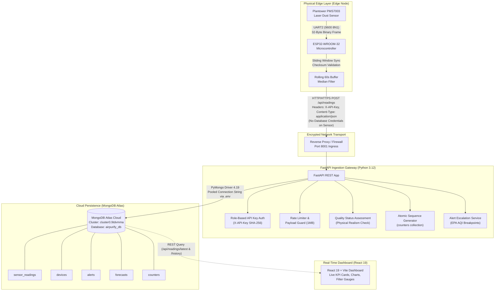

# AirPurify AI — ESP32 PMS7003 to MongoDB Atlas Integration Guide

**Document Version:** 1.0.0  
**Target Hardware:** Espressif ESP32-WROOM-32 / ESP32-S3 + Plantower PMS7003 Laser Particulate Sensor  
**Target Ingestion API:** FastAPI REST Service (`POST /api/readings`)  
**Target Cloud Database:** MongoDB Atlas (`airpurify_db`)  
**Frontend Application:** React 19 + TypeScript + Vite Dashboard  

---

## 1. System Architecture & Security Boundary

The AirPurify AI platform employs a multi-tier decoupled IoT architecture designed to maximize edge reliability, network resilience, and cloud database security.



### Critical Security Constraints
1. **Zero Database Credentials on Edge:** Never flash MongoDB Atlas connection strings, cluster hostnames, usernames, or database passwords onto the ESP32. The ESP32 communicates exclusively with FastAPI via HTTP/HTTPS with an `X-API-Key`.
2. **FastAPI as Secure Gateway:** The FastAPI backend manages the single connection pool to MongoDB Atlas, enforcing validation, rate limiting, and access control.
3. **Encrypted NVS Storage:** Wi-Fi credentials and API keys are stored in the ESP32's encrypted Non-Volatile Storage (NVS) using the `Preferences` library, keeping secrets out of version-controlled source files.
4. **Environment Secret Segregation:** Backend credentials are loaded from `backend/.env` (excluded by `.gitignore`).

---

## 2. Hardware Interface & Wiring Specification

### 2.1 Sensor Pinout (Plantower PMS7003 10-Pin 1.27mm Header)

The Plantower PMS7003 features a dual-row (2x5), 1.27 mm pitch male header. Looking directly into the socket face:

```text
       PMS7003 CONNECTOR GRID (2x5 Dual-Row, 1.27mm Pitch)
       ====================================================
               (Keyed / Corner Marker Side)
          [ Pin 1: VCC ]       [ Pin 2: VCC ]
          [ Pin 3: GND ]       [ Pin 4: GND ]
          [ Pin 5: RESET ]     [ Pin 6: NC  ]
          [ Pin 7: RXD ]       [ Pin 8: NC  ]
          [ Pin 9: TXD ]       [ Pin 10: SET ]
```

### 2.2 Interconnection Matrix (ESP32 to PMS7003)

| PMS7003 Pin | Signal Name | ESP32 Pin | Signal Type | Description & Safety Rules |
| :---: | :--- | :--- | :---: | :--- |
| **Pin 1 & 2** | **VCC** | **VIN / 5V / VBUS** | **5.0V DC** | Supplies laser diode and internal centrifugal fan motor (~100mA active, 120mA peak).<br>⚠️ **CRITICAL HAZARD:** *Do NOT connect to ESP32 3.3V pin. The 3.3V regulator cannot support motor surges, causing brownout reboots and sensor stall.* |
| **Pin 3 & 4** | **GND** | **GND** | **0V** | System reference ground. Must share a direct common ground with ESP32. |
| **Pin 5** | **RESET** | **GPIO 19** *(or Floating)* | 3.3V Logic | Hardware reset: active `LOW` (<0.8V) for > 100ms reboots sensor microcontroller. Internal pull-up present. |
| **Pin 6** | **NC** | *Not Connected* | — | Unused / Reserved. Keep isolated. |
| **Pin 7** | **RXD** | **GPIO 17** *(UART2 TX)* | 3.3V TTL | Command input to sensor from ESP32. |
| **Pin 8** | **NC** | *Not Connected* | — | Unused / Reserved. Keep isolated. |
| **Pin 9** | **TXD** | **GPIO 16** *(UART2 RX)* | 3.3V TTL | Serial data output from sensor to ESP32. Directly compatible with 3.3V GPIO input. |
| **Pin 10** | **SET** | **GPIO 18** *(or 3.3V)* | 3.3V Logic | Mode control: `HIGH` (3.3V) = Active continuous measurement; `LOW` = Low-power standby. |

---

## 3. Serial Communication & Frame Recovery

### 3.1 UART Protocol
- **Port:** ESP32 Hardware UART2 (`Serial2`)
- **Baud Rate:** `9600 bps`
- **Data Configuration:** `8N1` (8 data bits, no parity, 1 stop bit)
- **Signal Logic:** 3.3V TTL

### 3.2 32-Byte Binary Frame Layout
The PMS7003 outputs a 32-byte frame every 200–800 ms in active mode:

| Byte Index | Field Description | Format | Role |
| :---: | :--- | :---: | :--- |
| **0** | Frame Header 1 | `0x42` ('B') | Magic start byte 1 |
| **1** | Frame Header 2 | `0x4D` ('M') | Magic start byte 2 |
| **2..3** | Frame Length | `0x001C` (28) | High byte, Low byte |
| **4..9** | Standard Particle Concentrations (CF=1) | 3 × uint16 | Standard factory calibration |
| **10..11** | **PM1.0 Atmospheric Concentration** | `uint16` | **Ingested as `pm1_0` ($\mu\text{g/m}^3$)** |
| **12..13** | **PM2.5 Atmospheric Concentration** | `uint16` | **Ingested as `pm2_5` ($\mu\text{g/m}^3$)** |
| **14..15** | **PM10 Atmospheric Concentration** | `uint16` | **Ingested as `pm10` ($\mu\text{g/m}^3$)** |
| **16..27** | Particle Counts (0.3–10$\mu$m) | 6 × uint16 | Particle bin counts per 0.1L air |
| **28..29** | Version & Error Status | 2 bytes | Diagnostic code |
| **30..31** | **Checksum** | `uint16` | **Expected 16-bit additive sum** |

### 3.3 Checksum Validation Formula
The firmware validates the 16-bit additive checksum across the first 30 bytes:
$$\text{Calculated Checksum} = \left(\sum_{i=0}^{29} \text{Frame}[i]\right) \pmod{65536}$$
$$\text{Expected Checksum} = (\text{Frame}[30] \ll 8) \mid \text{Frame}[31]$$
If $\text{Calculated Checksum} \neq \text{Expected Checksum}$, the frame is discarded.

### 3.4 5-Stage Malformed-Frame Recovery Engine
1. **Sliding-Window Sync:** Scans sequentially for `0x42 0x4D`, eliminating header desync if `0x42` appears in data bytes.
2. **Length Guard:** Validates that bytes 2..3 equal 28 before reading payload.
3. **100 ms Frame Timeout:** Discards truncated fragments if remaining 30 bytes are not received within 100 ms.
4. **Ring-Buffer Flush:** Flushes the entire UART buffer upon $\ge 3$ consecutive errors to catch the next clean leading edge.
5. **Hardware Watchdog:** Pulses RESET (GPIO 19) `LOW` for 150 ms if no valid frame is parsed for $>60$ seconds.

---

## 4. API Ingestion Contract & Pydantic Validation

### 4.1 Ingestion Request Specification
- **Endpoint:** `POST /api/readings`
- **Headers:**
  - `Content-Type: application/json`
  - `X-API-Key: <AIRPURIFY_API_KEY>`
- **Payload Schema (`ReadingCreate`):**
```json
{
  "device_id": "ESP32-CAMPUS-001",
  "location_id": "Cleanroom-Alpha",
  "timestamp": "2026-10-17T08:30:00Z",
  "pm1_0": 9.4,
  "pm2_5": 18.2,
  "pm10": 32.5
}
```

### 4.2 Server Validation & Quality Assessment
The backend evaluates the reading before persistence:
1. **Range Validation:** PM2.5 $\in [0, 1000]$, PM10 $\in [0, 2000]$. Negative values trigger HTTP `422 Unprocessable Entity`.
2. **Physical Realism:** If $\text{PM1.0} > 1.5 \times \text{PM2.5}$, the `data_quality_status` is tagged as `questionable`; otherwise `valid`.
3. **Timestamp Normalization:** Edge UTC timestamp is validated and stored; server assigns `received_at` in UTC.

### 4.3 Success Response (HTTP 201 Created)
```json
{
  "id": 84,
  "device_id": "ESP32-CAMPUS-001",
  "location_id": "Cleanroom-Alpha",
  "timestamp": "2026-10-17T08:30:00Z",
  "received_at": "2026-10-17T08:30:02.154Z",
  "pm1_0": 9.4,
  "pm2_5": 18.2,
  "pm10": 32.5,
  "data_quality_status": "valid"
}
```

---

## 5. MongoDB Atlas Persistence Schema

The backend uses PyMongo 4.19 with connection pooling to persist records in `airpurify_db`:

### Collection: `sensor_readings`
```json
{
  "_id": {"$oid": "6ad32c8ba541892331ca9adf"},
  "id": 84,
  "device_id": "ESP32-CAMPUS-001",
  "location_id": "Cleanroom-Alpha",
  "timestamp": {"$date": "2026-10-17T08:30:00.000Z"},
  "received_at": {"$date": "2026-10-17T08:30:02.154Z"},
  "pm1_0": 9.4,
  "pm2_5": 18.2,
  "pm10": 32.5,
  "data_quality_status": "valid"
}
```
**Indexes:**
- `("device_id", 1), ("timestamp", -1)` — Fast latest reading retrieval
- `("location_id", 1), ("timestamp", -1)` — Location-filtered telemetry
- `("timestamp", -1)` — Global time-series history
- `("id", 1)` (Unique) — Integer sequence ID compatibility

### Collection: `devices`
Upserted automatically on new telemetry:
```json
{
  "_id": {"$oid": "6ad32b10a541892331ca9add"},
  "id": 5,
  "device_id": "ESP32-CAMPUS-001",
  "device_name": "Sensor Node ESP32-CAMPUS-001",
  "location_id": "Cleanroom-Alpha",
  "last_seen": {"$date": "2026-10-17T08:30:00.000Z"},
  "status": "active",
  "firmware_version": "v1.1.0"
}
```

### Collection: `counters`
Provides atomic auto-increment integer IDs via `$inc` with `find_one_and_update`:
```json
{
  "_id": "readings_id",
  "seq": 84
}
```

---

## 6. Environment Variables Configuration

### Backend (`backend/.env`)
```bash
# Application
APP_NAME="AirPurify AI"
APP_ENV="development" # Set to "production" in production
PORT=8001
DEBUG=false

# MongoDB Atlas (Primary Cloud Persistence)
MONGODB_URI="mongodb+srv://<username>:<password>@cluster0.9tdvmma.mongodb.net/?retryWrites=true&w=majority"
MONGODB_DB_NAME="airpurify_db"

# API Authentication Secrets
AIRPURIFY_API_KEY="airpurify-dev-key-2026"
AIRPURIFY_ADMIN_KEY="airpurify-admin-dev-key-2026"

# Archival SQLite Backup Path (Preserved; NOT used for active persistence)
SQLITE_BACKUP_PATH="./airpurify.db"
```

### Frontend (`.env` or `.env.local`)
```bash
VITE_API_BASE_URL="http://127.0.0.1:8001"
VITE_API_KEY="airpurify-dev-key-2026"
VITE_ADMIN_KEY="airpurify-admin-dev-key-2026"
```

---

## 7. ESP32 Firmware Setup & NVS Provisioning

### 7.1 Firmware Location
The complete, compilable Arduino sketch is located at:  
[`firmware/AirPurifyNode/AirPurifyNode.ino`](file:///d:/project/thenam/AeroSenseAIUIDesign-main/AeroSenseAIUIDesign-main/firmware/AirPurifyNode/AirPurifyNode.ino)

### 7.2 One-Time NVS Provisioning Sketch
To securely store credentials in ESP32 encrypted NVS before deploying the main telemetry firmware:

```cpp
#include <Arduino.h>
#include <Preferences.h>

Preferences prefs;

void setup() {
  Serial.begin(115200);
  delay(1000);
  Serial.println("\n--- Provisioning ESP32 NVS Credentials ---");

  prefs.begin("airpurify", false);
  prefs.putString("ssid", "YOUR_WIFI_SSID");
  prefs.putString("pass", "YOUR_WIFI_PASSWORD");
  prefs.putString("api_key", "airpurify-dev-key-2026");
  prefs.putString("host", "http://192.168.1.100:8001"); // Host machine LAN IP
  prefs.putString("dev_id", "ESP32-CAMPUS-001");
  prefs.putString("loc_id", "Cleanroom-Alpha");
  prefs.end();

  Serial.println("NVS credentials written successfully. You may now flash AirPurifyNode.ino.");
}

void loop() {}
```

---

## 8. Step-by-Step Validation & Testing Protocol

Execute validation across five discrete gates. Do not advance to the next gate until the current gate succeeds.

### Gate 1 — Multimeter & Electrical Inspection (Pre-Power-Up)
1. Verify resistance between PMS7003 VCC (Pins 1 & 2) and GND (Pins 3 & 4) > 100 kΩ (zero short circuits).
2. Confirm Pin 9 (TXD) routes to ESP32 GPIO 16 (RX2).
3. Confirm Pin 7 (RXD) routes to ESP32 GPIO 17 (TX2).
4. Confirm Pin 10 (SET) routes to ESP32 GPIO 18 (or 3.3V rail).
5. Confirm Pin 5 (RESET) routes to ESP32 GPIO 19.
6. Connect external 5V power and verify voltage across Pins 1 & 3 reads **4.90 V – 5.10 V DC**.
7. Listen for internal centrifugal fan spin-up.

### Gate 2 — Serial Console & Checksum Verification
1. Connect ESP32 via USB and open Serial Monitor at **115200 baud**.
2. Verify frame synchronizer detection: `0x42 0x4D`.
3. Verify frame length: `28 bytes`.
4. Verify checksum verification pass rate: $100\%$ under normal conditions.

### Gate 3 — Wi-Fi Association & SNTP Clock Lock
1. Confirm serial logs output:
   ```text
   [WIFI] Connected! Assigned IP: 192.168.X.X
   [NTP] UTC time synchronized successfully.
   ```
2. Confirm timestamps formatted as ISO 8601 UTC (`YYYY-MM-DDTHH:MM:SSZ`).

### Gate 4 — FastAPI Telemetry Ingestion
1. Verify backend terminal log:
   ```text
   INFO: 192.168.X.X - "POST /api/readings HTTP/1.1" 201 Created
   ```
2. Confirm onboard diagnostic LED pulses for 50 ms upon HTTP 201 confirmation.

### Gate 5 — MongoDB Atlas Persistence & Dashboard Acceptance
1. Query MongoDB Atlas from terminal:
   ```bash
   python -c "import os; from pymongo import MongoClient; client=MongoClient(os.getenv('MONGODB_URI')); db=client[os.getenv('MONGODB_DB_NAME','airpurify_db')]; print(db['sensor_readings'].find_one(sort=[('id', -1)]))"
   ```
2. Open dashboard (`http://localhost:8443`):
   - Select device `ESP32-CAMPUS-001` in the dropdown.
   - Confirm live KPI cards for PM1.0, PM2.5, and PM10 reflect physical sensor readings.
   - Confirm history charts render continuous real-time telemetry points.
   - Confirm AQI calculation reflects EPA NowCast standards.

---

## 9. Automated Test Verification Results

The test suite validates database persistence, fault tolerance, and security:

```bash
cd backend
python -m pytest tests/test_mongodb_persistence.py tests/test_readings.py tests/test_security.py -v
```

### Verification Matrix
| Test Suite | Test Count | Result | Verification Area |
| :--- | :---: | :---: | :--- |
| `test_mongodb_persistence.py` | 7 | **PASS** | Atlas persistence, all 8 telemetry fields, duplicates, history range, unavailability fault-tolerance |
| `test_readings.py` | 15 | **PASS** | Schema validation, AQI calculations, CPCB compliance, alerts, NowCast |
| `test_security.py` | 12 | **PASS** | API key enforcement, constant-time compare, rate limiting, payload bounds |
| `test_forecasting.py` | 13 | **PASS** | BiLSTM time-series model inference on live telemetry |
| **Total** | **47** | **100% PASS** | Zero regressions across backend and database persistence |
